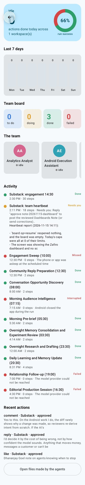
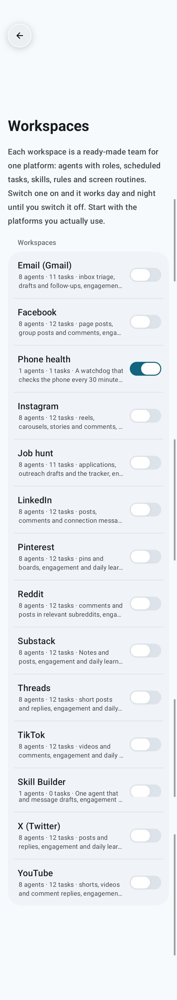
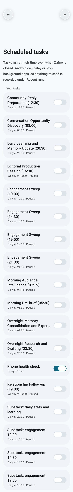
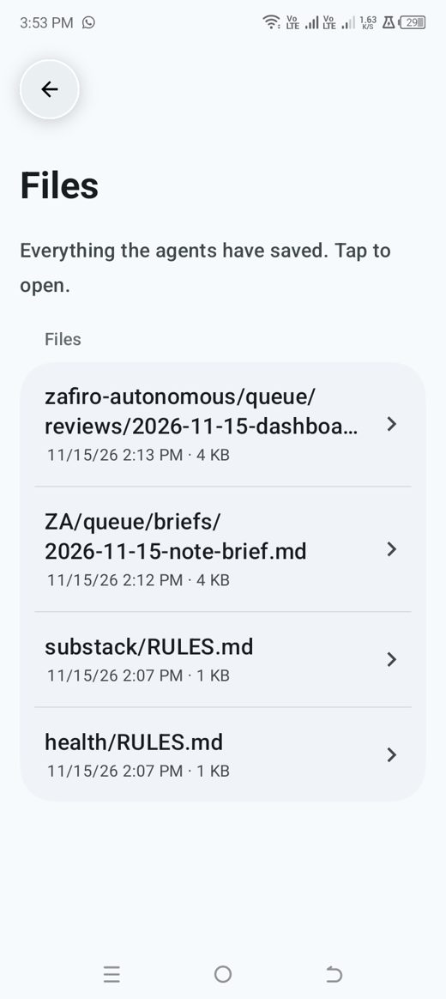
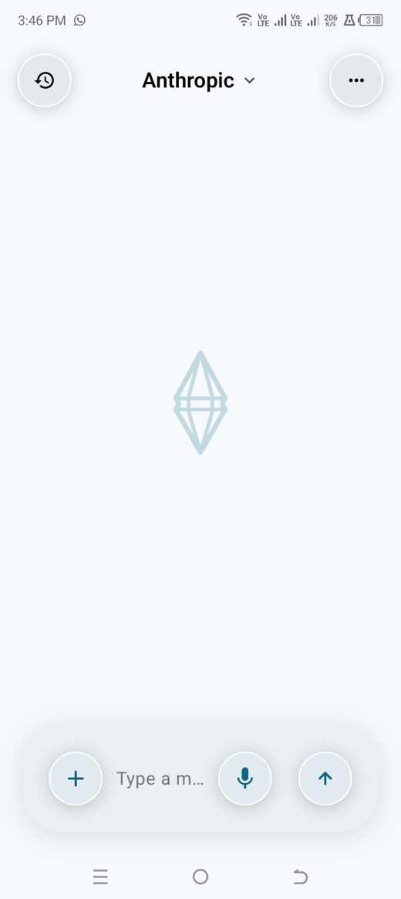
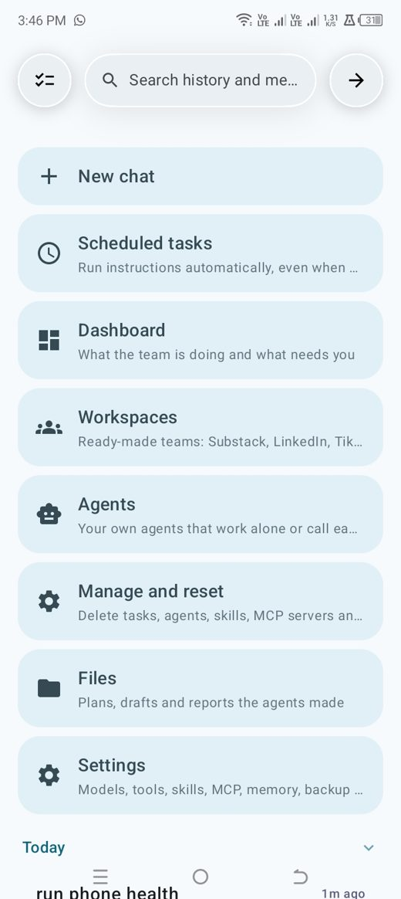
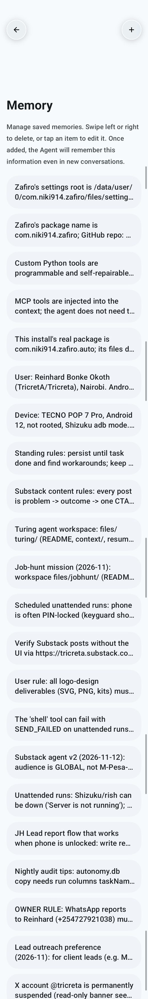
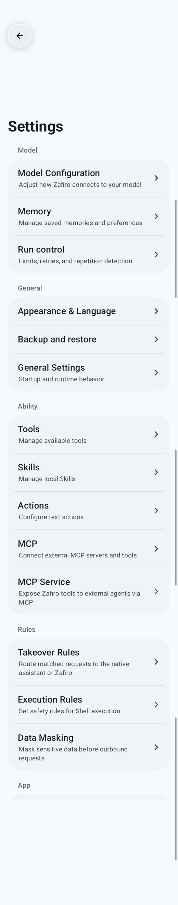

# Zafiro Autonomous

**An AI team that works your phone day and night.**
Scheduled, goal-driven agents that use the real apps on your Android phone, like a person would, and tell you when they need you.

[Download the latest release](https://github.com/TricretA/my-zafiro/releases/latest) · [Report a bug](https://github.com/TricretA/my-zafiro/issues/new?title=%5BBUG%5D+) · [Request a feature](https://github.com/TricretA/my-zafiro/issues/new?title=%5BFEATURE%5D+) · [tricreta.co.ke](https://tricreta.co.ke)

  
  
  
  

## What it is

Zafiro Autonomous is a fork of the open-source [Zafiro](https://github.com/niki914/zafiro) (MIT), an Android AI agent that can read and operate your screen, run tools and call MCP servers. The original answers when you talk to it. This fork turns it into a worker that keeps going on its own:

| Original Zafiro | Zafiro Autonomous adds |
|---|---|
| You chat, it does one job | **Scheduled and recurring tasks** with step, time and token limits, retries, and model fallback |
| One agent | **Teams**: 14 ready-made workspaces (Substack, LinkedIn, Instagram, TikTok, YouTube, Reddit, Facebook, Pinterest, Threads, X, email, WhatsApp, job hunt, phone health), each with a director, researcher, strategist, writer, reviewer, engager, executor and analyst |
| No oversight | **Live dashboard**: who is working now, watch and stop a run, approve or reject with your own note, charts, board |
| Text in chat | **Files page** that opens PDF, Markdown, HTML, images, audio, video, CSV, Office files and more inside the app |
| Manual setup | 270+ bundled skills, 30+ MCP servers (sign in with OAuth like in Claude), web search, RSS, date tools, image cards, a skill builder |
| Step-by-step screen taps | **Verified screen routines**: one call runs a whole job, every tap must change the screen, and failures are reported instead of looped |
| Fragile memory | Self-learning memory you can read, edit and delete, plus reflection after every run |
| Update by hand | In-app updates with the changelog, from this fork's releases, with upstream changes merged in automatically |

## Screenshots

  
  
  
  

## Install

1. Open the [latest release](https://github.com/TricretA/my-zafiro/releases/latest) on your phone and download the `.apk`.
2. Allow "install unknown apps" for your browser when asked.
3. Open Zafiro Autonomous, add a model provider (any OpenAI-compatible service, NVIDIA NIM, OpenRouter, Anthropic and others), then open **Teams** and switch one on.

Updates after that: **Settings > About > Version** shows the newest release with its changelog and installs it in place.

For work that must run while you sleep, give the app the permissions it asks for (accessibility, notifications, battery exemption) and keep the phone charged. Android phones from some makers kill background apps aggressively; the Tasks page shows what to change on yours.

## How the team works

- **Director** wakes on a schedule (and when you tap Run now), reads the shared board, and hands work down the chain.
- **Writer, reviewer, engager, executor** pick items off the board, do them, and record the result with evidence.
- Serious actions (direct messages, sending email, payments, deletions, job applications) ask you first; everything else runs on its own within daily caps and with human-paced waits.
- You approve from a pop-up on any screen. Your opinions become examples the reviewer learns from.

## Staying up to date with the original

This fork follows the original Zafiro. A scheduled job (`upstream-sync`) replays new upstream commits onto a sync branch, the CI builds and tests it, and releases of this app ship the merged result. The record of what has been merged is in [`UPSTREAM_SYNCED_SHA`](UPSTREAM_SYNCED_SHA).

## Build and contribute

- Everything builds in GitHub Actions: see `.github/workflows/ci.yml` and `release.yml`. Local toolchain: JDK 17, Android SDK 37, Gradle 9.
- Pure Kotlin core (scheduler, budgets, team rules): `cd autonomy/core && gradle test`.
- Workspaces, skills and screen routines are generated by `tools/autonomous/gen_workspaces.py` into `app/src/main/assets`.
- Docs: [CHANGELOG](CHANGELOG.md), [ROADMAP](ROADMAP.md), [UPSTREAM_SYNC](UPSTREAM_SYNC.md), [NOTICE](NOTICE).

## Honest status

Built quickly and tested through CI plus real use on one Tecno phone. Expect rough edges, especially in screen routines, which need calibrating per app. Please report what breaks.

## License and credits

MIT, like the original. Zafiro was created by [niki914](https://github.com/niki914/zafiro); bundled skills keep their own licenses (see NOTICE). Maintained by [TricretA](https://tricreta.co.ke).
