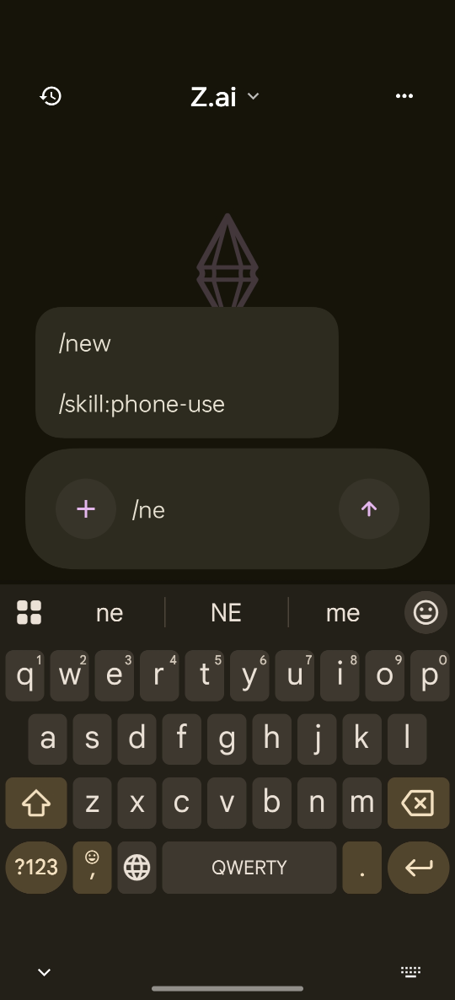
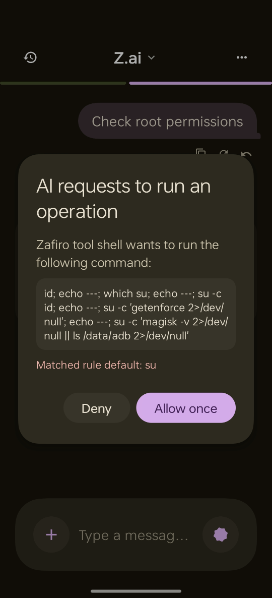
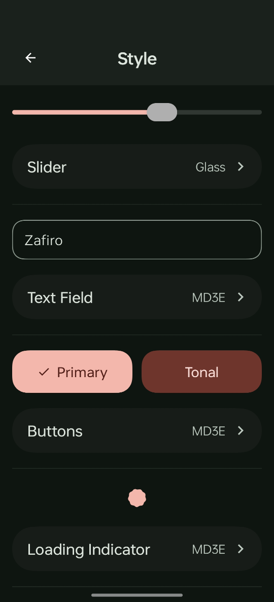
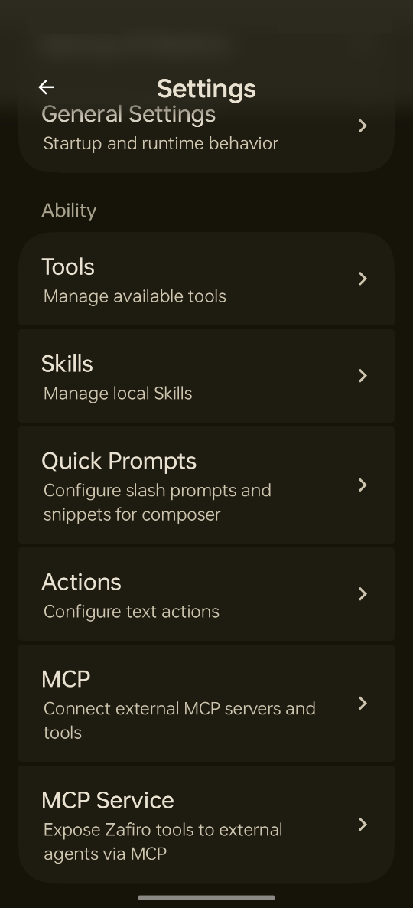
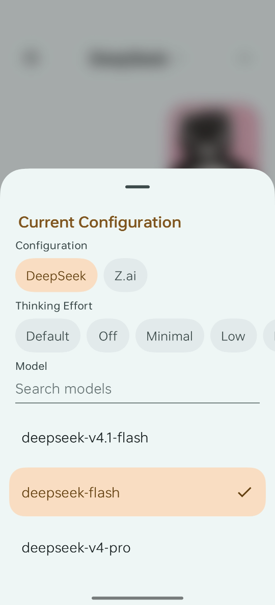
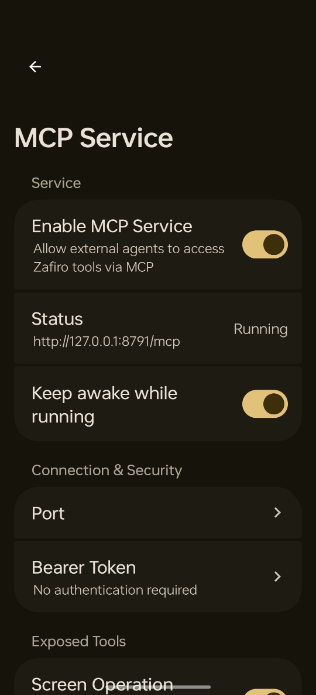

<div align="right">

[中文](README_CN.md) | [Release](https://github.com/niki914/zafiro/releases/latest)

</div>

<p align="center">
  
</p>

<p align="center">
  <a href="https://github.com/niki914/zafiro/releases/latest">
    
  </a>
  <a href="https://github.com/niki914/zafiro/releases">
    
  </a>
  <a href="https://github.com/niki914/zafiro/stargazers">
    
  </a>
  <a href="https://deepwiki.com/niki914/zafiro">
    
  </a>
  <br/>
  
  <a href="https://app.codacy.com/gh/niki914/zafiro/dashboard?utm_source=gh&utm_medium=referral&utm_content=&utm_campaign=Badge_grade">
    
  </a>
</p>

## What is Zafiro?

Zafiro is an intelligent [BYOK](https://www.ibm.com/think/topics/byok) Agent with elegant UI design, running on Android.

Zafiro is more than just a chatbot—it can perform tasks across apps through Phone-Use, with full support for Skills, MCP, and memory. It can also run Shell and Python 3 natively and wrap tools on its own to perform tasks such as web search and file downloads, or connect to a remote dev machine via SSH.

<p align="center">
  <video src="https://github.com/user-attachments/assets/58c60ada-bc71-4629-8ffc-86ea34da0144" autoplay loop muted playsinline width="100%"></video>
</p>

<p align="middle">
  
  
  
  
  
  
  
</p>

## Installation

[Download here](https://github.com/niki914/zafiro/releases/latest) or [build from source](#build-from-source)

## Core Capabilities

### Agent System

- **Out-of-the-Box** - built-in BYOK support for OpenAI, Anthropic, Google Gemini, DeepSeek, OpenRouter, etc.
- **Extend as Needed** - full support for Skills, MCP, memory and a workspace — extend it your way
- **Safety & Privacy** - sensitive data masking and per-command safety checks
- **Agentic** - inspect context window usage, rewind, fork, "/" recommendations and more
- **Local-first** - keep your sessions local with safe backup & restore
- **Expose as MCP** - expose Zafiro as an MCP server to your coding agents

### Phone-Use

- **Screen Interaction** - open apps, pick music, order food — all done for you, in the background
- **Visual Screen** - a mini screen shows every step Zafiro takes
- **Stability** - leverages a11y trees, screenshots and many other ways to get the job done

### Tooling

- **Shell & SSH** - run shell commands and connect to a machine like [Termux](https://github.com/termux/termux-app)
- **Python** - run Python 3 natively on your device
- **Quick text actions** - let Zafiro handle tasks for you in just one click
- **Android** - send notifications, launch apps, and open URLs smoothly
- **Extendable tool set** - web search, web page reading, and more tools built by Py-Meta-Tool

### Modern UI Design Language

- **[Material 3 Expressive](https://m3.material.io/) & Apple Liquid Glass** - your customized UI
- **Multilingual Support** - English, 中文, 日本語, Español, Русский and RTL languages
- **Background Interaction** - sleek floating bubble and notification tray UI to follow up on every task

## Voice Assistant Takeover (Root required)

Through the [LSPosed](https://github.com/lsposed/lsposed) framework, Zafiro can take over your system voice assistant — wake Breeno or XiaoAi, and Zafiro answers the questions.

Flexible settings let you decide when to invoke Zafiro and when to fall back to your default assistant.

<details>
<summary>Demos</summary>

<table align="center" width="100%">
  <tr>
    <th width="50%" align="center">Breeno</th>
    <th width="50%" align="center">XiaoAi</th>
  </tr>
  <tr>
    <td width="50%" align="center"></td>
    <td width="50%" align="center"></td>
  </tr>
</table>

</details>

## Community

- [Telegram](https://t.me/+ZPX2xtSl6RwyZGNl) — discuss, ask questions, give feedback
- [GitHub Issues](https://github.com/niki914/zafiro/issues) — report bugs or request features

When reporting an issue, please include as much detail as possible: phone model and Android version, system voice assistant and its version, Zafiro version, steps to reproduce, and screenshots or screen recordings.

## Sponsorship

We welcome sponsorships through the following channels:

- [Afdian](https://afdian.com/a/niki914)

## Tech Stack

| Category         | Technology                                                                   |
|------------|----------------------------------------------------------------------|
| Language         | [Kotlin](https://kotlinlang.org/)                                    |
| UI Framework      | [Jetpack Compose](https://developer.android.com/jetpack/compose)     |
| Design Language       | [Material Design 3 Expressive](https://m3.material.io/)              |
| Liquid Glass       | [Android Liquid Glass](https://github.com/Kyant0/AndroidLiquidGlass) |
| Agent Runtime  | [Okia](https://github.com/niki914/okia)                              |
| Python Runtime | [Chaquopy](https://chaquo.com/chaquopy/)                             |
| System Takeover       | [LSPosed](https://github.com/lsposed/lsposed) + [Xposed API](https://api.xposed.info/reference/packages.html)           |
| Terminal / SSH   | [libterm](https://github.com/niki914/libterm)                        |
| SVG Rendering      | [coil-resvg](https://github.com/hash-sequence/coil-resvg) (resvg)    |
| G2 Rounded Corners | [Capsule](https://github.com/Kyant0/Capsule)                         |

## Build from Source

> [!NOTE]
>
> Requirements
> 
> - Android Studio (or Android SDK + JDK 17)
> - An Android 8+ device

1. Clone this repo: `git clone https://github.com/niki914/zafiro.git`
2. Enter the project directory: `cd zafiro`
3. Build the debug APK: `./gradlew assembleDebug` (or install to device: `./gradlew installDebug`)
<details>
<summary>Release Signing</summary>

To build a Release version yourself, use your own signing key:

```bash
keytool -genkeypair -v -keystore my-release.jks \
  -keyalg RSA -keysize 2048 -validity 10000 -alias my_key

./gradlew assembleRelease \
  -PRELEASE_STORE_FILE=/absolute/path/to/my-release.jks \
  -PRELEASE_STORE_PASSWORD=yourStorePassword \
  -PRELEASE_KEY_ALIAS=my_key \
  -PRELEASE_KEY_PASSWORD=yourKeyPassword
```

</details>

## Project Structure

```
./
├── accessibility/       # Accessibility screen driver: node tree extraction, gesture dispatch, virtual display
├── app/                 # Main app: Compose UI, AgentRuntimeService, Xposed hooks
├── business/            # Core business layer (separation of contracts and implementations)
│   ├── api/             # Public business contract interfaces
│   ├── agent/           # Agent core logic, conversation orchestration & state flow
│   ├── files/           # File attachments, document path resolution
│   ├── notification/    # Resident notification, foreground service & channel management
│   ├── permission/      # Unified permission manager (Root / Shizuku auto-granting, tool approval)
│   ├── application/     # Application management & lifecycle
│   ├── screen/          # Screen interaction contracts & DisplayPort abstraction
│   └── remote/          # Telemetry reporting & device profile
├── agent-runtime/       # Agent runtime: LLM invocation, Tool/Skill/MCP execution, Python runtime
├── xsettings/           # Lightweight configuration module (depended on by modules as needed)
├── store/               # Store persistence, IPC bridge (XIpcBridge)
├── ui-kit/              # Shared Compose components (Zafiro* primitives), ZafiroScreen shell, navigation
├── remote-view/         # Cross-process / floating RemoteView components
├── xposed-api/          # Xposed event types, shared constants (shared by main app and host process)
├── xposed-runtime/      # Xposed runtime, hook base classes
└── libs/
    ├── logging/         # Logging library
    ├── okia/            # Okia Agent runtime base library
    ├── shizuku/         # Shizuku privileged API bindings & display service encapsulation
    └── libterm/         # Terminal library (multiple backends: libsu, shizuku, ssh, etc.)
```

## Contributing

Pull requests are welcome!

### Steps

1. Fork this project
2. Create a feature branch (`git checkout -b feat/your-feature`)
3. Commit your changes (`git commit -m 'feat: add your feature'`, following [Conventional Commits](https://www.conventionalcommits.org/en/))
4. Make sure all Git hooks pass
5. Push to the branch (`git push origin feat/your-feature`)
6. Open a Pull Request

### Using Your Coding Agent

Before contributing using coding agents like Codex, make sure they have read the project's [AGENTS.md](AGENTS.md).

## License

MIT — see [LICENSE](LICENSE).

<p align="center">
  Made with ❤️‍🔥 by <a href="https://github.com/niki914">niki914</a>
</p>
