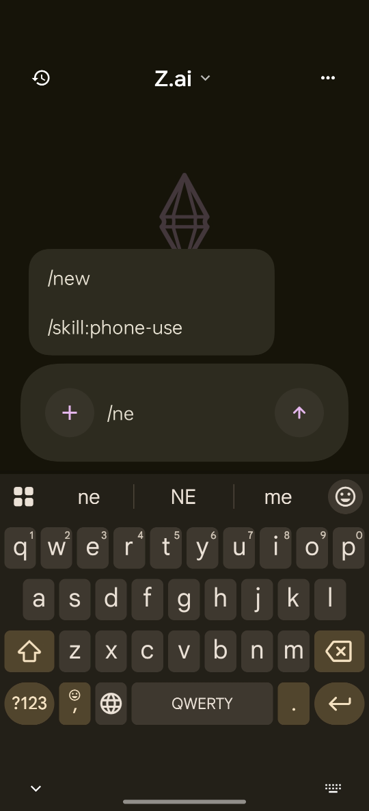
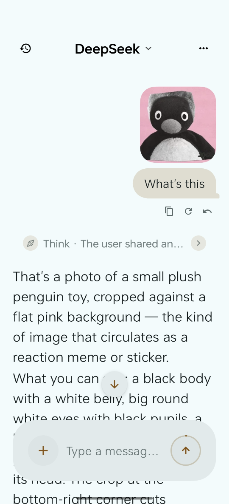
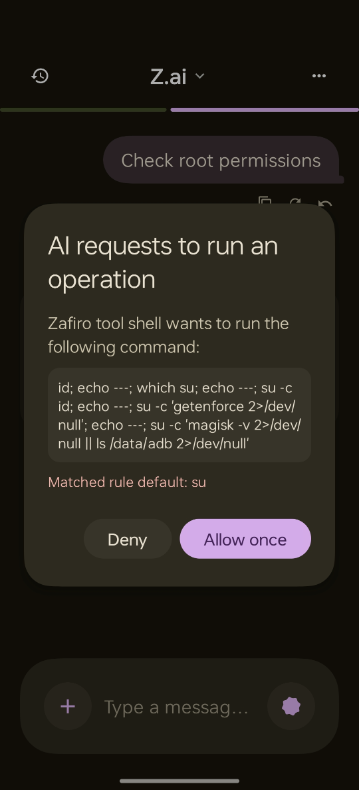
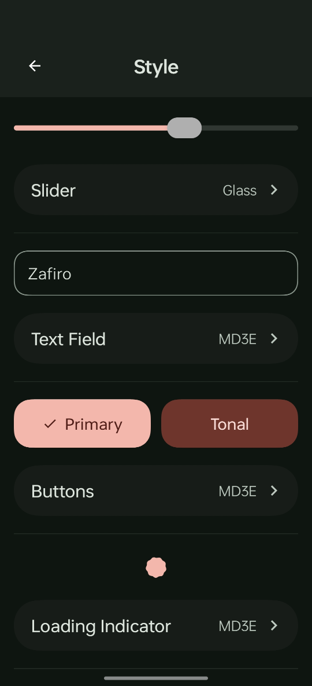
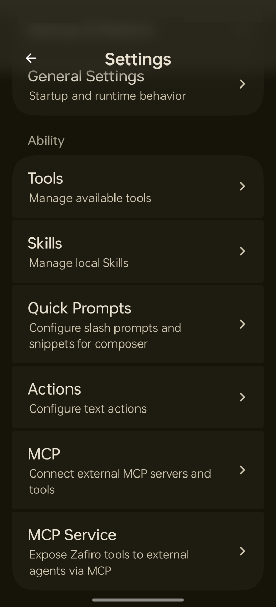
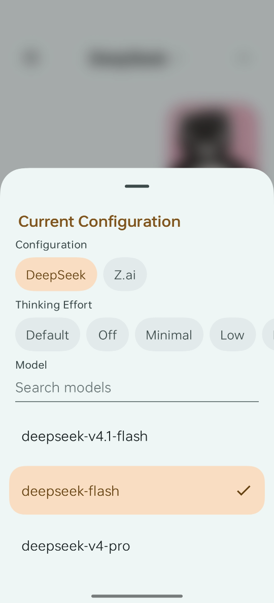
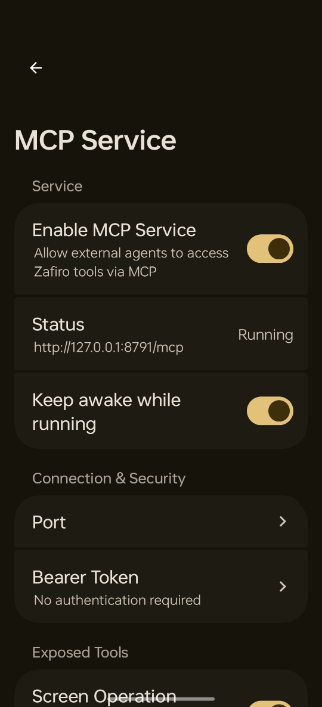
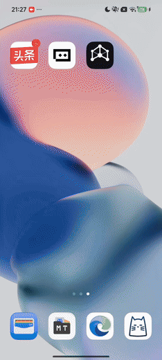

<div align="right">

[English](README.md) | [发行版](https://github.com/niki914/zafiro/releases/latest)

</div>

<p align="center">
  
</p>

<p align="center">
  <a href="https://github.com/niki914/zafiro/releases/latest">
    
  </a>
  <a href="https://github.com/niki914/zafiro/releases">
    
  </a>
  <a href="https://github.com/niki914/zafiro/stargazers">
    
  </a>
  <a href="https://deepwiki.com/niki914/zafiro">
    
  </a>
  <br/>
  
  <a href="https://app.codacy.com/gh/niki914/zafiro/dashboard?utm_source=gh&utm_medium=referral&utm_content=&utm_campaign=Badge_grade">
    
  </a>
</p>

## 什么是 Zafiro？

Zafiro 是一个运行在 Android 上的智能 [BYOK](https://www.ibm.com/think/topics/byok) Agent，拥有优雅的 UI 设计。

Zafiro 不仅仅是一个聊天机器人——它可以通过 Phone-Use 跨应用执行任务，并完整支持 Skills、MCP 和记忆。它还可以原生运行 Shell 与 Python 3，并自行封装工具来执行网络搜索和文件下载等任务，或通过 SSH 连接到远程开发机。

<p align="center">
  <video src="https://github.com/user-attachments/assets/58c60ada-bc71-4629-8ffc-86ea34da0144" autoplay loop muted playsinline width="100%"></video>
</p>

<p align="middle">
  
  
  
  
  
  
  
</p>

## 安装

[在此下载](https://github.com/niki914/zafiro/releases/latest) 或 [从源码构建](#从源码构建)

## 核心能力

### Agent 系统

- **开箱即用** - 对 OpenAI、Anthropic、Google Gemini、DeepSeek、OpenRouter 等提供 BYOK 支持
- **随心扩展** - 完整支持 Skills、MCP、记忆与工作区
- **安全与隐私** - 敏感数据脱敏与逐条命令安全检查
- **Agentic** - 查看上下文窗口占用、回退、分支、"/" 推荐等
- **本地优先** - 会话保留在本地，提供安全的备份与恢复
- **暴露为 MCP** - 将 Zafiro 作为 MCP 服务器开放给你的 Coding Agent

### Phone-Use

- **屏幕交互** - 打开应用、挑选音乐、点外卖——在后台为你完成一切
- **虚拟屏幕** - 迷你屏幕显示 Zafiro 执行的每一步
- **稳定性** - 利用无障碍树和截图等一切手段完成任务

### 工具

- **Shell 与 SSH** - 运行 Shell 命令或连上你的 [Termux](https://github.com/termux/termux-app)
- **Python** - 在设备上原生运行 Python 3
- **快捷文本操作** - 一键让 Zafiro 为你处理任务
- **Android** - 流畅地发送通知、启动应用和打开 URL
- **可扩展工具集** - 网络搜索、网页读取，以及更多由 Py-Meta-Tool 构建的工具

### 现代 UI 设计语言

- **[Material 3 Expressive](https://m3.material.io/) 与 Apple Liquid Glass** - 你的专属 UI
- **多语言支持** - English、中文、日本語、Español、Русский 以及 RTL 语言
- **后台交互** - 流畅的悬浮气泡与通知栏 UI，便于跟进每个进展

## 语音助手接管（需要 Root）

通过 [LSPosed](https://github.com/lsposed/lsposed) 框架，Zafiro 可以接管系统语音助手——唤醒 Breeno 或 XiaoAi，由 Zafiro 回答你的问题。

提供灵活的设置让你决定何时调用 Zafiro，何时回退到默认助手。

<details>
<summary>演示</summary>

<table align="center" width="100%">
  <tr>
    <th width="50%" align="center">小布助手</th>
    <th width="50%" align="center">小爱同学</th>
  </tr>
  <tr>
    <td width="50%" align="center"></td>
    <td width="50%" align="center"></td>
  </tr>
</table>

</details>

## 社区

- [Telegram](https://t.me/+ZPX2xtSl6RwyZGNl) — 讨论、提问、反馈
- [GitHub Issues](https://github.com/niki914/zafiro/issues) — 报告 Bug 或提出功能需求

报告问题时，请尽可能提供详细信息：手机型号与 Android 版本、系统语音助手及其版本、Zafiro 版本、复现步骤，以及截图或录屏。

## 赞助

我们欢迎通过以下渠道的赞助：

- [爱发电](https://afdian.com/a/niki914)

## 技术栈

| 类别         | 技术                                                                   |
|------------|----------------------------------------------------------------------|
| 语言         | [Kotlin](https://kotlinlang.org/)                                    |
| UI 框架      | [Jetpack Compose](https://developer.android.com/jetpack/compose)     |
| 设计语言       | [Material Design 3 Expressive](https://m3.material.io/)              |
| 液态玻璃       | [Android Liquid Glass](https://github.com/Kyant0/AndroidLiquidGlass) |
| Agent 运行时  | [Okia](https://github.com/niki914/okia)                              |
| Python 运行时 | [Chaquopy](https://chaquo.com/chaquopy/)                             |
| 系统接管       | [LSPosed](https://github.com/lsposed/lsposed) + [Xposed API](https://api.xposed.info/reference/packages.html)           |
| 终端 / SSH   | [libterm](https://github.com/niki914/libterm)                        |
| SVG 渲染      | [coil-resvg](https://github.com/hash-sequence/coil-resvg) (resvg)    |
| G2 圆角 | [Capsule](https://github.com/Kyant0/Capsule)                         |

## 从源码构建

> [!NOTE]
>
> 环境要求
> 
> - Android Studio（或 Android SDK + JDK 17）
> - 一台 Android 8+ 设备

1. 克隆此仓库：`git clone https://github.com/niki914/zafiro.git`
2. 进入项目目录：`cd zafiro`
3. 构建 Debug APK：`./gradlew assembleDebug`（或安装到设备：`./gradlew installDebug`）
<details>
<summary>Release 签名</summary>

若要自行构建 Release 版本，使用你自己的签名密钥：

```bash
keytool -genkeypair -v -keystore my-release.jks \
  -keyalg RSA -keysize 2048 -validity 10000 -alias my_key

./gradlew assembleRelease \
  -PRELEASE_STORE_FILE=/absolute/path/to/my-release.jks \
  -PRELEASE_STORE_PASSWORD=yourStorePassword \
  -PRELEASE_KEY_ALIAS=my_key \
  -PRELEASE_KEY_PASSWORD=yourKeyPassword
```

</details>

## 项目结构

```
./
├── accessibility/       # 无障碍屏幕驱动：节点树提取、手势派发、虚拟屏幕
├── app/                 # 主应用：Compose UI、AgentRuntimeService、Xposed 钩子
├── business/            # 业务核心层（契约与实现分离）
│   ├── api/             # 业务对外公共契约接口
│   ├── agent/           # Agent 核心逻辑、会话编排与状态流
│   ├── files/           # 文件附件、文档路径解析
│   ├── notification/    # 常驻通知、前台服务与通知渠道管理
│   ├── permission/      # 统一权限管理器（Root / Shizuku 自动授权、工具审批）
│   ├── application/     # 应用管理与生命周期
│   ├── screen/          # 屏幕交互契约与 DisplayPort 抽象
│   └── remote/          # 遥测上报与设备画像
├── agent-runtime/       # Agent 运行时：LLM 调用、Tool/Skill/MCP 执行、Python 运行时
├── xsettings/           # 轻量配置模块（业务按需依赖）
├── store/               # Store 持久化、IPC 桥（XIpcBridge）
├── ui-kit/              # 共享 Compose 组件（Zafiro* 元器件）、ZafiroScreen 壳、导航
├── remote-view/         # 跨进程 / 悬浮 RemoteView 组件
├── xposed-api/          # Xposed 事件类型、共享常量（主应用与宿主进程共享）
├── xposed-runtime/      # Xposed 运行时、Hook 基类
└── libs/
    ├── logging/         # 日志库
    ├── okia/            # Okia Agent 运行时基础库
    ├── shizuku/         # Shizuku 特权 API 绑定与显示服务封装
    └── libterm/         # 终端库（含多个后端：libsu, shizuku, ssh 等）
```

## 贡献

欢迎提交 Pull Request！

### 步骤

1. Fork 本项目
2. 创建特性分支（`git checkout -b feat/your-feature`）
3. 提交你的更改（`git commit -m 'feat: add your feature'`，遵循 [Conventional Commits](https://www.conventionalcommits.org/zh-hans/)）
4. 确保所有 Git hook 均已通过
5. 推送到分支（`git push origin feat/your-feature`）
6. 提交 Pull Request

### 使用你的 Coding Agent

在使用类似 Codex 的 Coding Agent 参与贡献之前，确保它们已阅读本项目的 [AGENTS.md](AGENTS.md)。

## 许可证

MIT — 详见 [LICENSE](LICENSE)。

<p align="center">
  Made with ❤️‍🔥 by <a href="https://github.com/niki914">niki914</a>
</p>
