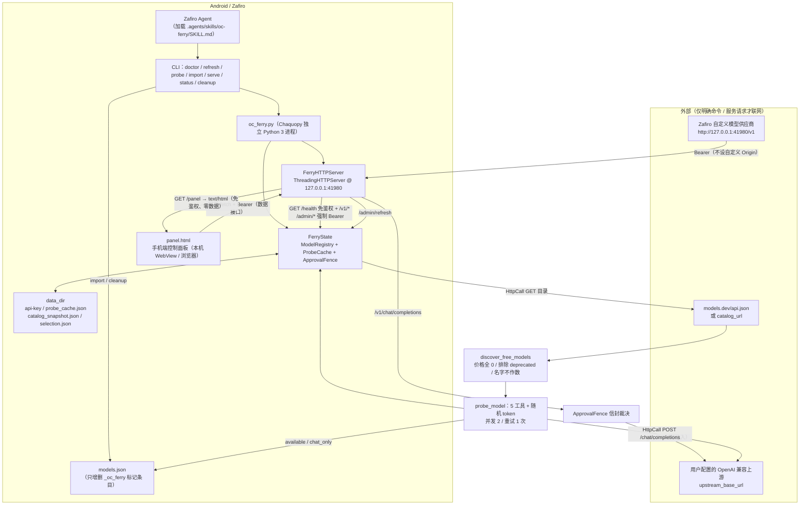

# OC Ferry 手机端设计文档（Zafiro drop-in patch）

> 目标仓库：`niki914/zafiro`。本文说明把桌面 Electron 应用
> [HRuiCcc/RuiC-oc-ferry](https://github.com/HRuiCcc/RuiC-oc-ferry) 的核心能力移植到
> Android / Zafiro 的架构、取舍、安全边界与合入方式。
> 状态：设计定稿 + 实现完成。

---

## 1. 背景与既定技术判断

OC Ferry 桌面版把 OpenCode 免费模型池「摆渡」给桌面 AI 客户端，五条核心链路：
发现、体检、缓存、写入、转发（外加审批围栏）。

**Android 上不可能内置隔离的 OpenCode / Node / Electron 运行时**，这是硬约束。因此本次
手机端形态定为：

> **Zafiro 可直接加载的 Skill（`.agents/skills/oc-ferry/`）+ 端侧 Python 3 本机转发服务**
> （`oc_ferry.py`，纯标准库，由 Zafiro 通过 Chaquopy 在独立 Python 进程运行）。

由此产生的两处上游替换（**必须显式写进文档，避免误解**）：

| 桌面端 | 手机端 | 边界 |
| --- | --- | --- |
| OpenCode 本地进程提供推理 | **用户配置的 OpenAI 兼容上游端点** `upstream_base_url` + 可选 `upstream_api_key` | 需要用户自备 BYOK 端点；本 Skill 不提供任何模型额度，也不代理任何第三方账号 |
| OpenCode 免费模型池 | **`https://models.dev/api.json`**（或用户自填 `catalog_url` / 本地 `catalog_file`） | 目录是第三方公开元数据，价格字段随时可能变化；不做额度查询 |

**五条核心链路的逻辑与安全边界保持不变**：发现规则、体检判定码与重试策略、双 TTL
缓存、只动自己标记条目的安全写入、回环 OpenAI 兼容转发与审批围栏，全部忠实移植。

---

## 2. 架构



关键设计点：

- **所有网络 I/O 都经过可注入的 `HttpCall`**（签名 `Callable[[HttpRequest], HttpResponse]`）。
  纯逻辑路径（`doctor` / `status` / `cleanup` / `import` / 发现 / 判定 / 合并 / 围栏）
  **绝不联网**；`import oc_ferry` 零副作用（不读文件、不建目录、不联网、不生成密钥）。
- 服务端启动**不联网**：`FerryState` 从 `catalog_snapshot.json` 加载目录；只有
  `refresh` / `probe` / `admin/refresh` / `admin/probe` 和客户端聊天请求才联网。
- `HttpResponse.error` 把超时/网络异常编码成数据，让重试策略可被离线单测完整覆盖。

---

## 3. 模块地图

全部实现集中在单文件 `.agents/skills/oc-ferry/oc_ferry.py`（Python 3.8+，标准库）。

| 模块 / 类 | 职责 |
| --- | --- |
| `FerryConfig` | dataclass 配置；`from_dict` / `resolved_paths` / `validate`（强制 `host=127.0.0.1`） |
| `HttpRequest` / `HttpResponse` / `HttpCall` / `urllib_http_call` | 可注入 HTTP 层；流式用惰性生成器 |
| `discover_free_models` | 链路 1：价格字段判定 + deprecated 排除 + 名字不作数；产出 `opencode/` 前缀 id |
| `build_probe_body` / `judge_probe` / `probe_model` / `ProbeVerdict` / `ProbeResult` | 链路 2：5 工具、随机 token、四级判定码 + 运输层分级、重试策略 |
| `ProbeCache` | 链路 3：JSON 持久化、6h / 10min 双 TTL、能力指纹失效、损坏降级 |
| `FileLock` / `merge_models_file` / `cleanup_models_file` / `WriteReport` | 链路 4：备份 / 锁 / `os.replace` / 只动标记条目 / 内容不变不写 |
| `ApprovalFence` / `Envelope` / `FenceResult` | 审批围栏：信封编解码、本机动作拒绝与转交、响应改写 |
| `ModelRegistry` / `build_client_entries` / `FerryState` | 目录索引、客户端条目生成、状态与命令编排 |
| `FerryHandler` / `FerryHTTPServer` / `_guard()` / `_handle_panel()` / `PANEL_FILENAME` | 链路 5：回环 OpenAI 兼容端口 + 8 个数据/管理接口 + `GET /panel` 面板交付（免 Bearer/免 Origin 零数据静态页、503 JSON 缺失错误、数据接口 Bearer + Origin 围栏） |
| `FerryState.status_snapshot()` / `panel.html` | 手机端控制面板：全量模型状态快照 + 单文件移动优先 UI |
| `cmd_*` / `build_parser` / `main` | CLI 七个子命令 |

---

## 4. 五条链路的手机端映射

### 4.1 发现

`discover_free_models(catalog: dict) -> List[dict]`：

- 只按 `input / output / cache_read / cache_write` **四个价格全为 0** 判定；价格兼容
  `cost` 子对象与顶层字段两种结构；完全没有价格元数据的条目不算免费。
- **`deprecated` 直接排除**（识别 `deprecated` 真值、`status == "deprecated"`）。
- **名字含 `free` 完全不参与判定**（函数从不读名字做免费判断，名字只用于展示）。
- 产出规范化记录：`id = opencode/<provider>/<model>`、`upstream_model = <provider>/<model>`、
  `provider`、`name`、`fingerprint`、`cost`，按 id 稳定排序。
- 目录来源：`catalog_url`（默认 models.dev）→ 本地 `catalog_file` 优先 → 也可由
  `POST /admin/refresh` 的 `{"catalog": {...}}` 离线注入。

### 4.2 体检

- `build_probe_body(model_id, token)`：5 个工具 `Read / Write / Bash / Glob / WebSearch`、
  `tool_choice: "auto"`（允许自由选择）、`parallel_tool_calls: false`、`stream: false`、
  要求读 `/external/probe-<token>.txt`。
- `judge_probe(response, token)` 忠实移植 `src/probe.js`：

  | 判定码 | 条件 | 手机端处置 |
  | --- | --- | --- |
  | `ok` | 恰好 1 个 tool_call，name=`Read`，`file_path` 含 token | `available`，开放工具 |
  | `no_action` | 无 `tool_calls`（只回文本）；桌面 probe 端点**实际抛 502** | 重试 1 次；仍无动作 → `chat_only`，关闭工具 |
  | `probe_mismatch` | 调用数 ≠ 1 / 名字 ≠ `Read` / `file_path` 不含 token | 重试 1 次；仍不符 → `offline` |
  | `invalid_model_output` | 响应整体不是合法 chat completion | 不重试 → `chat_only` |
  | `invalid_tool_call` | `tool_calls` 结构 / `arguments` JSON 非法 | 不重试 → `chat_only` |
  | `timeout` / `network` / `http_error` / `rate_limited` | 手机端新增运输层分级 | 不重试 → `offline` / `rate_limited` |

- `probe_model`：**仅 `no_action` 与 `probe_mismatch` 重试 1 次**；超时、格式失败、
  HTTP/网络错误一律不重试。任一次 `ok` 立即通过。
- 超时 60s（`request_timeout`，可配）；并发默认 **2**（桌面为 3，手机省电，可配）。
- 诚实交代：`refresh` 对每个免费模型最多发 2 次短请求，消耗少量免费额度。

### 4.3 缓存

`ProbeCache`（`probe_cache.json`）：

- 判定（`available` / `chat_only` / `offline`）保留 **6 小时**（`success_ttl_minutes=360`）。
- 当时负载状态保留 **10 分钟**（`load_ttl_minutes=10`）；`rate_limited` 判定也按 10 分钟失效，
  过期后可重新体检。`get_load()` 与 `put_load()` 独立维护。
- 按 **模型 ID + 能力指纹** 失效：`_capability_fingerprint` 用
  `tool_call / reasoning / attachment / modalities / limit / knowledge / 价格` 等字段算 sha256 前 16 位，
  能力变化自动让旧判定失效。
- 跨重启 / 跨进程：每次 `get`/`put` 重新读盘 + 同目录临时文件 `os.replace`，
  进程内 `RLock` 串行化；损坏文件安全降级为空缓存，下次写入前备份 `.corrupt-<ts>`。

### 4.4 写入

`merge_models_file` / `cleanup_models_file`：

- 支持**裸数组** `[...]` 与 **`{"models": [...]}`** 两种形态，写回时保持原形态；
  对象形态会原样保留其它顶层键。
- **唯一可增删依据** `_oc_ferry.managed == true`：用户手写条目（哪怕 id 恰好以 `OC · ` 开头）
  一律保留；客户端可见 id 前缀 `OC · `，上游 id 保持 `opencode/`。
- 写前 `.oc-ferry.bak` 备份 → `FileLock`（`O_CREAT|O_EXCL` + stale 清理）→
  同目录临时文件 + `fsync` + `os.replace` 原子替换。
- **内容没变就不落盘**：比较写回前后整份文档的规范化 JSON。
- 文件损坏 / 结构不认识 → `ModelsFileError`，**拒绝覆盖**。
- `serve` 优雅退出（Ctrl-C）时自动 `cleanup`，避免残留指向已停止端口的失效条目。

### 4.5 转发

`FerryHandler` + `FerryHTTPServer`：

- `ThreadingHTTPServer` 只绑 `127.0.0.1:41980`（`validate()` 强制 `host`）。
- **安全边界 = 只绑 loopback + 数据接口 Bearer + 静态页零数据**：
  - `GET /panel` 与 `GET /` **免 Bearer、免 Origin 检查**，只返回同目录 `panel.html`
    静态 HTML 骨架，**不含任何模型 / 状态 / 密钥数据**——这是必需的，否则用户还没输
    key 就打不开页面（浏览器地址栏无法设置 `Authorization` 头）。`panel.html` 缺失 /
    不可读时返回明确的 **503 JSON** 错误（`type: panel_unavailable`），不抛异常崩溃。
  - `GET /health` 是**仅回环、免 Bearer、免 Origin** 的非敏感存活探针，只返回
    `status / service / version / host / port / 计数 / upstream_configured /
    upstream_host / panel_path / time`，**不含** api_key / upstream_api_key / 模型明细。
  - **所有模型数据与全部管理操作**由 `/v1/*` 与 `/admin/*` 提供，用
    `hmac.compare_digest` 定时比较**强制 `Authorization: Bearer <api-key>`**。
- **手机端 Origin 差异（重要）**：桌面端不给浏览器用，任何带 `Origin` 的请求一律 403；
  手机端控制面板必须能从本机 WebView / 浏览器打开，因此桌面端围栏被**收窄**为
  「**只在 `/v1/*` 与 `/admin/*` 上拒绝非同源 `Origin`**」（防 DNS rebinding / CSRF /
  恶意网页）；`/panel`、`/`、`/health` **不做 Origin 检查**。同源判定为
  `scheme ∈ {http, https}` + `host ∈ {127.0.0.1, localhost}` + 端口一致，
  `Origin: null`（沙箱 / `file://`）仍拒绝。**同源 Origin 必须放行**：浏览器对同源
  POST 也会自动附加 `Origin`，若一并拒绝，面板自己的 `fetch` 会全部 403 而不可用。
- 请求体上限 8MB（超限 413，不支持 chunked）；并发上限 4（`BoundedSemaphore`，超限 503）。
- 路由共 **8 个数据/管理接口 + 1 个面板入口（8+1）**，`GET /` 是 `GET /panel` 的别名：

  | 方法 | 路径 | 鉴权 / 说明 |
  | --- | --- | --- |
  | GET | `/health` | 免 Bearer、免 Origin，仅回环，只返回非敏感状态（含 `upstream_configured` / `upstream_host` / `cache_entries` / `panel_path`） |
  | GET | `/panel`（或 `/`） | **免 Bearer、免 Origin、零数据静态 HTML**（`text/html; charset=utf-8`）；文件缺失 → 503 JSON |
  | GET | `/v1/models` | Bearer；只列 `available` / `chat_only` |
  | POST | `/v1/chat/completions` | Bearer；转发，支持 `stream: true` 的 SSE 逐块输出 |
  | POST | `/admin/refresh` | Bearer；刷新目录并体检（可注入 catalog） |
  | POST | `/admin/probe` | Bearer；单模型体检 |
  | POST | `/admin/import` | Bearer；安全合并写入 |
  | GET / POST | `/admin/selection` | Bearer；查看 / 设置（`{"clear": true}` 取消）当前选中模型 |
  | GET | `/admin/status` | Bearer；面板用的全量状态：所有模型 + 四档计数 + selection |

  **没有** `POST /admin/cleanup`：清场是有副作用的动作，统一由 CLI `cleanup` 或
  `serve` 退出时完成；面板「清理」按钮只给出明确的 CLI 提示，**不伪造 HTTP 接口**。

- 桌面端 `target` / `system-proxy` / `find-config` 三个 admin 路由是 Electron 桌面特有能力
  （系统代理、目标客户端探测），Android 无对应概念，手机端不实现；由 Zafiro 自定义模型
  供应商直接指向 `http://127.0.0.1:41980/v1` 代替。
- `chat_only` 模型转发时会剥掉 `tools` / `tool_choice` / `parallel_tool_calls` / `functions`
  （关闭工具）；`rate_limited` / `offline` / 未注册模型一律 404，不提供给客户端。
- 上游转发用 `urllib.request`（标准库），Bearer 只注入 `upstream_api_key`，绝不下发客户端 key。

### 4.6 手机端控制面板（桌面控制面板的对应物）

「做成手机端」不能只有 CLI：桌面 Electron 托盘应用自带控制面板，手机端对应物是
`.agents/skills/oc-ferry/panel.html` —— 单文件、零依赖、纯原生 HTML/CSS/JS、无 CDN / 外链、
移动优先（`viewport`、`viewport-fit=cover`、竖屏单列、≥44px 点击区、`env(safe-area-inset-*)`、
`prefers-color-scheme` 浅色/深色）。

- **访问方式**：`serve` 运行时在**设备本机**浏览器 / Zafiro WebView 打开
  `http://127.0.0.1:41980/panel`（`GET /` 是同一页面）。`GET /panel` 由 `_handle_panel()`
  从脚本同目录读取 `panel.html` 返回 `text/html; charset=utf-8`；**免 Bearer、免 Origin
  检查**，文件缺失 / 不可读返回明确的 **503 JSON** 错误（`type: panel_unavailable`），
  不抛异常、不崩溃。
- **页面免鉴权但不返回数据（关键设计）**：`panel.html` 只是静态 UI 骨架，**不含任何
  模型 / 状态 / 密钥信息**。这是必需的——浏览器地址栏无法设置 `Authorization` 头，若
  `/panel` 要求 Bearer，用户还没输 key 就打不开页面。因此不采用「401 解锁壳页」方案，
  直接免鉴权交付静态页；所有数据由 `/health`、`/v1/*`、`/admin/*` 提供并严格鉴权。
  未输 key 时页面正常打开、顶部状态条由免鉴权的 `/health` 探针渲染，模型区显示
  「请先填入 API Key」提示；填入 key 后数据接口才返回内容。
- **api-key 位置**：`<data_dir>/api-key`（`serve` 启动会打印，或 `config.json` 的 `api_key`）。
  面板输入框把 key 存浏览器 `localStorage`（键 `oc-ferry-api-key`），**不写进 URL、
  不发到任何第三方、不写服务端日志**。
- **能力**：顶部服务状态（运行中 / 端口 / 上游 host / 已缓存模型数）+ api-key 输入框；
  四档状态卡片（可用 / 仅对话 / 限流 / 下线）来自 `GET /admin/status`；每个模型行可展开
  详情并「只重测这一个」（`POST /admin/probe`）；操作按钮覆盖检测全部（`refresh`）、
  写入客户端（`import`）、重新体检（`probe`）、勾选 / 取消（`selection`）。
  **「清理自己写入的条目」按钮只给出明确的 CLI 提示**（服务无 HTTP 清场路由，
  用 CLI `cleanup` 或停止 `serve` 时自动清场），不伪造接口。所有数据请求同源、
  只带 `Authorization`（POST 另带 `Content-Type`），**不手动设置 `Origin`**；
  加载态 / 成功 / 错误均有可见反馈。
- **与桌面端 UI 的能力对照**：

  | 能力 | 桌面端控制面板 | 手机端 `panel.html` |
  | --- | --- | --- |
  | 形态 | Electron 原生窗口 | 本机 WebView / 浏览器静态单页（免鉴权、零数据） |
  | 状态 / 四档 / 模型明细 | 有 | 有（`/health` 探针 + Bearer 的 `/admin/status` + `/v1/models`） |
  | 检测全部 / 单模型重测 / 写入 / 选中 | 有 | 有（对应 `admin/*`，全部 Bearer） |
  | 清理条目 | 有 | **按钮给出明确 CLI 提示**（无 HTTP 清场路由） |
  | 系统代理 / 目标客户端切换 | 有 | 无（Android 无对应概念） |
  | api-key | 桌面应用配置 | 浏览器 `localStorage`，不写 URL / 日志 |
  | 浏览器访问 | 不支持（`Origin` 一律 403） | 支持：`/panel` 免鉴权；`/v1/*`、`/admin/*` 拒绝非同源 Origin、同源放行 |
  | 页面鉴权 | 原生窗口无需鉴权 | **免 Bearer 但零数据**；数据接口全部强制 Bearer |

- **安全说明**：面板**只在设备本机可达** —— 服务只绑 `127.0.0.1`、`host` 被
  `validate()` 强制，不监听 `0.0.0.0`、不对外暴露、不经过任何公网 / CDN / 第三方服务；
  请勿把端口转发到公网或改 `host`。整体边界为
  **只绑 loopback + 数据接口 Bearer + 静态页零数据**；`Origin` 围栏只保护数据接口。
  这是手机端相对桌面端（不给浏览器用）唯一有意放宽的地方。

---

## 5. 审批围栏与信封协议

**核心不变量：模型只能用 JSON 信封表达「想做什么」，执行权始终留在客户端，
服务端永不自行执行本机动作。**

信封格式（`oc_ferry_envelope` 为必需键）：

```json
{
  "oc_ferry_envelope": 1,
  "type": "text | tool_request | external_tool_call | rejected | normalized",
  "tool": "search",
  "arguments": {"query": "..."},
  "content": "...",
  "requests": [],
  "reason": "..."
}
```

`ApprovalFence` 的行为（**类中没有任何执行路径**：无 subprocess、无 `os.system`、无文件写入）：

1. `decode(content)`：非 JSON / 缺 `oc_ferry_envelope` → `rejected`；非信封纯文本在
   `evaluate` 中被**规范化**成 `text` 信封（`normalized`），保证「模型只能用信封表达意图」。
2. `is_local_action(tool, arguments)`：命中 `shell / bash / exec / file / file_path /
   command / localhost / 127.0.0.1 / termux / adb / ...` 等关键词即视为本机动作。
3. `evaluate(message)`：汇总 `tool_calls` 与信封里的动作意图；命中本机动作 →
   `allowed=False`，`local_actions_rejected` 计数，生成 `external_tool_call` 信封
   （`delegated: true`、`blocked_local: true`），**拒绝执行、转交客户端**。
4. `rewrite(response, result)`：剥离危险 `tool_calls`，把 `message.content` 替换为安全信封 JSON，
   并附 `oc_ferry_fence` 审计字段；非流式响应统一走这条路径。
5. 流式 SSE：无法在完整消息到达前安全重写，因此**只透传**并以
   `X-OC-Ferry-Fence: stream-passthrough` 标注审计边界；执行权仍由 Zafiro Agent 掌握。
   这是明确的已知边界（见第 8 节）。

Zafiro Agent 收到 `external_tool_call` 时应先向用户说明并确认，再决定是否用自己的工具执行。

---

## 6. 缓存策略汇总

| 数据 | 有效期 | 失效条件 | 存放 |
| --- | --- | --- | --- |
| 体检判定（status / verdict / tools_enabled） | 6 小时 | 过期、`fingerprint` 变化、时钟回拨 | `probe_cache.json` |
| 负载状态（load_state） | 10 分钟 | 过期；`put_load` 可单独刷新 | `probe_cache.json` |
| `rate_limited` 判定 | 10 分钟 | 按 `load_checked_at` 判定 | `probe_cache.json` |
| 目录快照 | 直到下次 `refresh` | 文件损坏 → 安全降级为空 | `catalog_snapshot.json` |
| 本机 api_key | 持久 | 用户手动删除文件后重新生成 | `api-key`（0600） |

---

## 7. 桌面端 vs 手机端取舍（决策记录）

| 维度 | 桌面端 | 手机端 | 取舍理由 |
| --- | --- | --- | --- |
| 交付形态 | Electron 托盘应用 | Zafiro Skill + 单文件 Python 服务 | Android 无法内置隔离 OpenCode/Node/Electron 运行时 |
| 推理上游 | OpenCode 本地进程 | 用户自配 OpenAI 兼容端点 | 手机端只能 BYOK；不承诺任何免费额度 |
| 免费目录 | OpenCode 模型池 | `models.dev/api.json` / `catalog_url` | OpenCode 进程不存在；改用公开元数据（价格字段判定规则不变） |
| 体检并发 | 3 | **2**（可配） | 手机省电、减少并发请求 |
| 系统代理 / 目标客户端 | `system-proxy` / `target` / `find-config` | **移除**，改用自定义供应商直连回环 | Android 无桌面系统代理；Zafiro 原生支持 BYOK |
| 端口 / 回环 / 8MB / 并发 4 | 有 | **保留** | 安全边界不变 |
| `Origin` 围栏 | 任何带 `Origin` 一律 403（桌面不给浏览器用） | **收窄**：仅 `/v1/*` 与 `/admin/*` 拒绝非同源 `Origin`，同源放行；`/panel`、`/`、`/health` 不检查 | 手机端控制面板必须可从本机 WebView / 浏览器访问；同源 POST 会自动带 `Origin`，一并拒绝会让面板失效 |
| 控制面板 | Electron 原生窗口 | `panel.html` 单文件移动优先静态页（`GET /panel`，`/` 别名） | 手机端必须有可见控制面板，不能只有 CLI |
| 面板鉴权 | 原生窗口无需鉴权 | **免 Bearer、免 Origin，但零数据静态页**；数据接口全部强制 Bearer | 浏览器地址栏无法设置 `Authorization` 头，要求 Bearer 会导致用户还没输 key 就打不开页面 |
| 面板文件缺失 | 不适用 | **503 JSON** 明确错误（`panel_unavailable`），不崩溃 | 静态文件从脚本同目录读取，部署缺文件时需可诊断 |
| 清场接口 | 桌面 UI 内动作 | **无 HTTP 清场路由**，按钮给 CLI 提示；CLI `cleanup` / `serve` 退出清场 | 清场有副作用，避免伪造接口；与 CLI 语义保持一致 |
| 5 工具 + 随机 token + 判定码 + 重试策略 | 有 | **保留** | 核心链路不变 |
| 备份 / 锁 / 原子替换 / 只动标记条目 / 退出清场 | 有 | **保留** | 核心链路不变 |
| 审批围栏 / JSON 信封 | 有 | **保留**（流式仅审计透传） | 执行权始终在客户端 |
| 语言 / 依赖 | Node.js | Python 3.8+ 纯标准库 | Zafiro 通过 Chaquopy 原生运行 Python 3，避免引入新依赖 |

---

## 8. 安全边界与已知限制

**安全边界**

- 只监听 `127.0.0.1`；`host` 被 `validate()` 强制；控制面板**只在设备本机可达**，不对外暴露。
- 安全边界 = **只绑 loopback + 数据接口 Bearer + 静态页零数据**：`GET /panel` / `GET /`
  **免 Bearer、免 Origin 检查**，只返回不含任何模型 / 状态 / 密钥的静态 `panel.html`；
  `GET /health` 是免鉴权的非敏感存活探针；**所有模型数据与全部管理操作**由 `/v1/*`、
  `/admin/*` 用 `hmac.compare_digest` 定时比较强制 Bearer。
- `Origin` 围栏**只保护数据接口**：`/v1/*` 与 `/admin/*` 对**非同源** `Origin` → 403
  （同源 `127.0.0.1` / `localhost` 且端口一致放行，`Origin: null` 拒绝；
  同源放行是面板 `fetch` 可用的必要条件）；`/panel`、`/`、`/health` 不做 Origin 检查。
  8MB 请求体、并发 4。
- 面板 `panel.html` 零 CDN / 外链；api-key 只存浏览器 `localStorage`，不写 URL / 日志；
  `panel.html` 缺失 / 不可读返回 503 JSON，不崩溃。
- `upstream_api_key` 只发往上游；本机 `api_key` 存 0600 文件 `api-key`，`/health` 不泄露。
- 只增删带 `_oc_ferry.managed` 标记的条目；写前备份 + 锁 + 原子替换；损坏文件拒绝覆盖。
- `ApprovalFence` 无执行路径；本机动作拒绝并转交客户端。
- 模块导入零副作用；纯逻辑命令不联网。

**已知限制**

1. 免费目录是第三方元数据，价格字段随时变化；上游**不提供剩余额度查询**。
2. 体检通过只代表「这一次能按协议产生动作」，不保证长期稳定或真实任务成功率。
3. 流式 SSE 下围栏只做审计透传（`stream-passthrough`），不做信封改写；如需强制围栏请使用非流式请求。
4. `upstream_base_url` 需要用户自备；默认的 `<provider>/<model>` 形式若上游不认，需用
   `upstream_model_map` 显式覆盖。
5. `models.json` 的字段是通用 BYOK 形态；若 Zafiro 某一版本采用不同字段命名，需按
   `SKILL.md` 的映射微调条目（合并/清场逻辑本身与字段无关）。
6. 不支持 chunked 请求体（返回 400）；OpenAI 兼容客户端通常使用 `Content-Length`。
7. 跨进程并发写缓存依赖 `os.replace` 原子性 + 进程内锁；极端并发下可能丢失一次判定更新
   （不会写坏文件，下次 refresh 会补齐）。
8. `rate_limited` / `offline` 模型不会出现在 `/v1/models`，也不会被转发；这是刻意行为（面板通过 `/admin/status` 仍能看到完整四档）。
9. `GET /panel` / `GET /` 免鉴权因此**任何能访问本机回环端口的进程都能取到静态页面骨架**，但页面零数据、不含任何模型 / 状态 / 密钥；真正的数据接口始终强制 Bearer。key 存 `localStorage`，清除浏览器数据后需重新输入。
10. 服务**不提供** HTTP 清场路由；面板「清理」按钮只给 CLI 提示，需执行 `python oc_ferry.py cleanup` 或停止 `serve`（退出自动清场）。
11. 面板依赖「浏览器同源策略 + 数据接口 Bearer + 仅 loopback + 静态页零数据」；若把 41980 端口转发到公网或改 `host`（`validate()` 已禁止），安全边界即失效——这是不支持的用法。

---

## 9. 测试策略（QA 提供，已随 patch 一并交付）

单元/集成测试放在 `.agents/skills/oc-ferry/test_*.py`，运行：

```bash
python -m unittest discover -s .agents/skills/oc-ferry -p "test_*.py"
```

建议覆盖（全部通过注入 `HttpCall` 离线完成，不依赖真实网络）：

- `discover_free_models`：价格全 0 / 有一个非 0 / `deprecated` / 名字含 free 但收费 / 无价格元数据；
  扁平目录与 `provider.models` 两种结构。
- `build_probe_body`：5 工具名、`parallel_tool_calls is False`、token 出现在提示里。
- `judge_probe`：`ok` / `no_action` / `probe_mismatch`（调用数、工具名、token 三种） /
  `invalid_model_output` / `invalid_tool_call` / `http_status_hint == 502`。
- `probe_model`：注入 `HttpResponse(error="timeout: ...")` 验证「超时不重试」、
  注入 429 验证限流、注入 `no_action`×2 验证 `chat_only`、注入第 2 次 `ok` 验证重试成功、
  注入 `invalid_tool_call` 验证不重试。
- `ProbeCache`：6h / 10min 双 TTL、指纹失效、损坏文件降级、跨实例读写。
- `merge_models_file` / `cleanup_models_file`：裸数组与 `{"models":[]}` 两种形态、
  用户条目保留、内容不变不写、备份生成、损坏文件拒绝覆盖、其它顶层键保留。
- `ApprovalFence`：本机动作拒绝 + 转交、合法信封通过、纯文本规范化、`rewrite` 剥离 tool_calls。
- `FerryHandler`：用注入 `HttpCall` + 真实 `FerryHTTPServer` 起本地端口，验证
  `/v1/*` 与 `/admin/*` 上非同源 `Origin`→403、同源 `Origin` 放行、`/panel` 与
  `/health` 不做 Origin 检查、错误 Bearer→401、超限→413、`/health` 免鉴权且不泄露密钥、
  `/v1/models`、非流式围栏改写、stream SSE 输出、8 个数据/管理接口 + 1 个面板入口。
- 控制面板：`GET /panel` **不带 Bearer** → 200 + `text/html; charset=utf-8` 且内容为
  `panel.html`；带任意 `Origin` / 错误 Bearer 仍 200；`GET /` 别名同样 200；页面不含
  模型 / 状态 / 密钥数据；临时移走 `panel.html` → **503 JSON**（`panel_unavailable`）
  且不崩溃；`GET /admin/status` 四档计数与模型列表一致；`POST /admin/selection` 的
  `clear` 生效；`POST /admin/cleanup` → 404（无此路由）；`/health` 含
  `cache_entries` / `upstream_configured` / `panel_path`。
- `doctor` / `status` / `cleanup` / `import` 断言无任何网络调用（注入一个会抛异常的
  `HttpCall` 替身即可证明）。
- 跨平台换行：`GET /panel` 按**二进制原样**透传 `panel.html` 字节，不做文本模式的
  隐式换行转换，并先 `decode("utf-8")` 校验编码（失败仍返回 503 JSON）。这样在
  `core.autocrlf=true` 把 checkout 写成 CRLF 的 Windows 环境下，响应体与磁盘文件
  仍逐字节一致；LF 与 CRLF 两种 checkout 均已实测 123/123 通过。
- 文档导出：`export` 的 md / json / csv 三种格式、`--catalog` 本地目录优先级、
  `--online` 走注入 `HttpCall`（证明调用次数与 URL）、无数据返回 1、
  缓存状态合并、Markdown 表格转义、原子写不留临时文件、HTTP 失败上报 —— 8 个用例，
  全部零真实联网。

---

## 10. 合入 upstream（`niki914/zafiro`）的文件清单

本 patch **共 14 个文件**（含 QA 的 123 个离线用例与 Termux 部署包）：

| # | 文件 | 动作 | 说明 |
| --- | --- | --- | --- |
| 1 | `.agents/skills/oc-ferry/SKILL.md` | 新增 | Zafiro Agent 加载的 Skill 说明（真实目录，**不要改 `.claude/skills` 软链**） |
| 2 | `.agents/skills/oc-ferry/oc_ferry.py` | 新增 | 单文件核心实现，纯标准库 |
| 3 | `.agents/skills/oc-ferry/config.example.json` | 新增 | 配置样例（合法 JSON，不含注释） |
| 4 | `.agents/skills/oc-ferry/panel.html` | 新增 | 手机端控制面板（单文件、零依赖、移动优先、免鉴权零数据静态页） |
| 5 | `.agents/skills/oc-ferry/README.md` | 新增 | 中文使用说明（含控制面板与桌面 UI 能力对照表） |
| 6 | `docs/OC_FERRY_MOBILE.md` | 新增 | 本文（设计文档） |
| 7 | `.agents/skills/oc-ferry/test_oc_ferry.py` | 新增 | QA 离线单测（123 用例，零真实联网） |
| 8 | `README.md`（工作区根目录） | **合入 upstream 时排除** | 本地交付说明：patch 清单、本地验证、合入步骤、MIT 与致谢 |
| 9 | `TERMUX.md` | 新增 | 手机 Termux 使用指南：安装、导出文档、体检转发、保活、FAQ |
| 10 | `termux/config.termux.json` | 新增 | Termux 配置模板（`setup.sh` 读取并展开 `$HOME`） |
| 11 | `termux/setup.sh` | 新增 | 初始化：装 Python、申请存储权限、生成 `config.json`、离线自检 |
| 12 | `termux/start.sh` | 新增 | 后台启动回环服务（PID + wake-lock + 日志） |
| 13 | `termux/stop.sh` | 新增 | 优雅停止（SIGINT → 自动 cleanup） |
| 14 | `termux/export.sh` | 新增 | 一键导出免费模型文档（不需要 API Key、不消耗额度） |

根 `README.md` 是给交付方看的说明，**不是 Zafiro 的一部分**；上游仓库已有自己的 README，
直接 `git apply` 会冲突或覆盖它。合入 upstream 请执行
`git apply --exclude=README.md oc-ferry-mobile.patch`（或直接运行
`./push-to-github.sh upstream`），实际落地 **13 个文件**；若推送到你自己的独立仓库，
14 个文件全部保留，根 README 正好作为仓库首页。

生成的 `FREE_MODELS.md` / `.json` / `.csv` 是会随目录价格变动而过时的**数据快照**，
以及本机试用的 `config.local.json`、推送工具 `push-to-github.sh`、仓库包
`oc-ferry-mobile.bundle`，**都不打进 patch**。

> 手机 Termux 场景不需要 Zafiro / Chaquopy：核心是纯 Python 3 标准库 CLI，
> 见 `TERMUX.md`。`export` 链路默认离线，只有 `--online` 读取公开目录，
> 且不向模型发送任何推理请求。

合入时**不改动**任何现有 Zafiro 源码、现有依赖与 Gradle 配置；提交信息 / PR 标题使用英文
Conventional Commit（如 `feat: add oc-ferry mobile skill and loopback forwarder`）。
